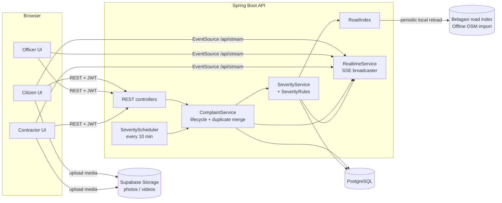

# CivicPulse — Civic Complaint & Accountability Platform

> **Spot it. Snap it. Get it fixed.**
> Citizens report civic issues with photo + GPS evidence, officers triage them by a data-driven
> severity score, contractors fix them with photo proof — and everyone sees progress live.

| | |
|---|---|
| **Backend** | Spring Boot 4 · Java 17 · Spring Security + JWT · Spring Data JPA · PostgreSQL (Supabase) |
| **Frontend** | React 19 · Vite · React Router 7 · Supabase Storage (media) |
| **Real-time** | Server-Sent Events (`/api/stream`) — no extra infrastructure |
| **Maps / context** | Locally indexed OpenStreetMap roads and precomputed network access |
| **Deploy** | Docker multi-stage image (`Dockerfile`, `docker-compose.yml`, see `DOCKER.md`) |

---

## Contents

1. [What the system does](#1-what-the-system-does)
2. [Architecture](#2-architecture)
3. [Severity analysis](#3-severity-analysis)
4. [Duplicate merging](#4-duplicate-merging-same-issue--one-complaint)
5. [Real-time updates](#5-real-time-updates)
6. [API reference](#6-api-reference)
7. [Running the project](#7-running-the-project)
8. [Project structure](#8-project-structure)
9. [Team plan (4 members)](#9-team-plan-4-members)
10. [Sprint plan](#10-sprint-plan)
11. [Backlog](#11-backlog)
12. [Way of working](#12-way-of-working)
13. [Known issues & security to-dos](#13-known-issues--security-to-dos)

---

## 1. What the system does

### Complaint lifecycle

```
PENDING ──verify──▶ VERIFIED ──assign──▶ ASSIGNED ──start──▶ IN_PROGRESS ──complete──▶ COMPLETED ──resolve──▶ RESOLVED
 (citizen)          (officer)            (officer)           (contractor)              (contractor)            (officer)
                                                                   ▲                         │
                                                                   └──────── reopen ─────────┘  (officer rejects the work)
```

### Roles

| Role | Landing page | What they can do |
|---|---|---|
| **Citizen** | `/citizen` | Report issues (photo/video + GPS), see *My reports* with a live status timeline, see when others reported the same issue ("You and 13 others reported this"), browse and upvote the community feed, find issues near them. |
| **Officer** | `/officer` | **Priority queue** ranked by severity score, KPI cards (critical, to verify, to assign, to sign off, SLA breached), severity distribution, *most reported* hotspots, full severity breakdown per issue, list of every citizen who reported it, verify / assign / reassign / resolve / send back, manual duplicate merge, re-run location analysis. |
| **Contractor** | `/contractor` | Work orders sorted by urgency, SLA countdown, number of affected citizens, *Navigate* (Google Maps), start work, upload proof-of-work photos, mark complete, city overview. New assignments appear instantly. |

The login page (`/`) follows the team wireframe: tagline banner on top, illustration on the left,
login credentials (email **or phone number** + password, Sign in, *No account yet? → Register*) on the right.

---

## 2. Architecture



**Request flow for a new report**

1. Citizen uploads media to Supabase Storage and sends `POST /api/complaints` with category, optional hazard evidence, GPS, address, and media URL.
2. `ComplaintService.create` looks for an **open complaint of the same category within ~35 m**.
   - Found → saved as a *child report* (`mergedIntoId`), master `reportCount + 1`, severity re-scored.
   - Not found → saved as a new master with a local severity assessment.
3. A `CREATED` / `MERGED` event is pushed to every open dashboard.
4. Officers can review reported evidence, choose a nearby road, and adjust operational priority. The correction requires a reason and publishes a `SEVERITY` event.

---

## 3. Severity analysis

The category selects deterministic hazard rules. Citizens can provide measurements or a visual assessment. The app scores the evidence entered by the citizen or reviewed by an officer.

| Factor | Default weight | Evidence |
|---|---:|---|
| Physical hazard | 40% | Category-specific dimensions, condition, position, exposure, or damage |
| Road importance | 25% | OSM classification (35%), graph connectivity (25%), mapped essential access (25%), traffic exposure (15%) |
| Public impact | 20% | Blockage (45%), exposure (30%), access disruption (25%) |
| Urgency | 15% | Immediate danger, injuries, reported deterioration, poor visibility, wiring, or disrupted emergency access |

Scores range from 0 to 100. When a value is unknown, the calculation uses the relative weights of the available values. The response includes evidence completeness and verification status. The defaults are Medium at 25, High at 50, and Critical at 80. Emergency evidence overrides the calculated priority with Critical. Uncertain emergency evidence is flagged for prompt review with at least High priority. The existing deadline escalation retains its High floor for open issues. Tune weights, priority thresholds, and pothole dimensions under `civic.severity.*` in `application.properties`.

When a recognized category has no measured hazard evidence, the app uses a provisional category estimate in the score and leaves physical hazard and evidence completeness unchanged. A report categorized as **Other** can stay pending if no usable evidence or road match is available.
The existing scheduler reassesses open issues, and officers can reassess or review a single issue. Reviews persist the officer, reason, evidence, road correction, operational priority, and timestamp on the complaint. Explicit corrections survive automatic reassessment. The existing complaint workflow handles responsibility and contractor assignment.

### Belagavi road setup

From the repository root, import once using Python 3. The generated local files are ignored by Git.

```powershell
python scripts/import_belagavi_roads.py --download --output .local-data/belagavi-roads.tsv --save-osm .local-data/belagavi.osm
```

The backend finds this index automatically when launched from the repository root or the backend directory. Use `--osm .local-data/belagavi.osm` in place of `--download` to rebuild offline. A deployment can schedule the importer periodically. It replaces the index atomically, and the backend checks for an updated file every five minutes. For a different path, set `CIVIC_SEVERITY_ROAD_INDEX`. In Docker, mount the data directory read-only and use the container path.

The importer builds a graph from shared OSM road nodes and identifies links whose closure would disconnect part of the mapped graph. Essential access uses mapped entrances and roads entering mapped facility boundaries. Nearby amenities alone do not contribute. Estimates depend on the study-area boundary and OSM coverage. The graph models undirected connectivity and does not evaluate turn restrictions, one-way routing, emergency routing policies, or actual detour time.

GPS matching uses local geometry and a grid index. An ambiguous match or missing GPS leaves road importance unknown until a usable match is available. This path works with standard PostgreSQL. Production PostGIS state was not inspected or modified. [OpenStreetMap contributors](https://www.openstreetmap.org/copyright) · [Supabase PostGIS setup](https://supabase.com/docs/guides/database/extensions/postgis)

### Optional verified vehicle surveys

No traffic file is required. In its absence, traffic exposure is marked as estimated from the OSM road class and the app displays no vehicle count. To supply an existing verified dataset, set `CIVIC_SEVERITY_VEHICLE_COUNT_CSV` to a local file URI such as `file:/C:/traffic/counts.csv`. The header is `start_lat,start_lon,end_lat,end_lon,period,vehicles,source`. A `YYYY-MM` row is a full monthly total, while a `YYYY` row is AADT in vehicles per day. Use WGS84 endpoints and unquoted values. The existing survey pipeline uses the last completed month and caches the lookup per road and month.

---

## 4. Duplicate merging (same issue → one complaint)

**Rule:** a new report is a duplicate when there is an **open** master complaint (`status` not
COMPLETED/RESOLVED) with the **same category** within the merge radius.

- Merge radius = `max(35 m, phone GPS accuracy)` capped at 75 m (`civic.dedup.*` properties).
- Candidate search: bounding-box SQL query, then exact Haversine distance; the nearest candidate wins.
- The new report is stored as a **child** (`mergedIntoId = master.id`) — the citizen still sees it in *My reports*.
- The master's `reportCount` goes up. New evidence of an emergency can raise the master's priority.
- Every status / contractor / severity change on the master is **mirrored onto all children**, so each reporter follows the repair.
- The same citizen reporting the same spot twice does **not** inflate the count (`submissionResult = ALREADY_REPORTED`).
- Officers only ever see masters. The detail pane lists every reporter with their own description and evidence.
- False negative? Officers can merge manually: `PUT /api/complaints/{duplicateId}/merge/{masterId}` (the *Duplicate of another issue?* box).
- A report after the master was COMPLETED/RESOLVED starts a **new** complaint (the problem came back).

`POST /api/complaints` returns `submissionResult`: `NEW`, `MERGED` or `ALREADY_REPORTED`, and the report page tells the citizen what happened.

---

## 5. Real-time updates

- Endpoint: `GET /api/stream?token=<JWT>` (Server-Sent Events; the token is a query parameter because `EventSource` cannot send headers).
- Event name `complaint`, payload `{ type, complaintId, masterId, complaint, at }`.
- Types: `CREATED`, `MERGED`, `UPDATED`, `SEVERITY`, `ESCALATED`.
- Heartbeat comment every 25 s keeps proxies (Render, Nginx) from closing the connection; `X-Accel-Buffering: no` disables buffering.
- Frontend hook `src/lib/useRealtime.js` reconnects automatically and re-fetches after a reconnect so nothing is missed. If the stream is down, dashboards poll every 30 s. The header shows **Live / Connecting / Offline**.

| Dashboard | Reacts to |
|---|---|
| Citizen | status changes on own reports (and on the master of merged reports), new reports in the community feed, "N citizens have now reported…" |
| Officer | every new report, merges (report count + severity jump), status changes, SLA escalations — rows flash, toasts + activity bell |
| Contractor | new assignments, reassignments, sign-off / send-back, report count changes |

> Single-instance broadcaster. If the backend is ever scaled to several instances, publish events through Postgres `LISTEN/NOTIFY` or Redis pub/sub (see backlog BE-12).

---

## 6. API reference

All endpoints except `/api/auth/*` expect `Authorization: Bearer <JWT>`.

| Method | Path | Who | Description |
|---|---|---|---|
| POST | `/api/auth/register` | public | `{name, email, phone?, password, role}`; officer accounts require administrator provisioning |
| POST | `/api/auth/login` | public | `{email: "<email or phone>", password}` → `{token, userId, name, email, phone, role}` |
| GET | `/api/stream?token=` | all | Server-Sent Events stream |
| POST | `/api/complaints` | citizen | create (auto-merge duplicates) |
| GET | `/api/complaints` | officer/contractor | master complaints, highest severity first (`?includeMerged=true` for all) |
| GET | `/api/complaints/my` | citizen | own reports incl. merged ones |
| GET | `/api/complaints/recent` | all | 20 newest masters (community feed) |
| GET | `/api/complaints/assigned` | contractor | own work orders |
| GET | `/api/complaints/nearby?latitude=&longitude=&radius=` | all | masters within radius (km) |
| GET | `/api/complaints/{id}` | all | one complaint |
| GET | `/api/complaints/{id}/reports` | officer | master + every merged report |
| PUT | `/api/complaints/{id}/verify` | officer | PENDING → VERIFIED |
| PUT | `/api/complaints/{id}/assign/{contractorId}` | officer | VERIFIED/ASSIGNED → ASSIGNED |
| PUT | `/api/complaints/{id}/start` | contractor | ASSIGNED → IN_PROGRESS |
| PUT | `/api/complaints/{id}/complete` | contractor | IN_PROGRESS → COMPLETED |
| PUT | `/api/complaints/{id}/resolve` | officer | COMPLETED → RESOLVED |
| PUT | `/api/complaints/{id}/reopen` | officer | COMPLETED → IN_PROGRESS |
| PUT | `/api/complaints/{dupId}/merge/{masterId}` | officer | manual duplicate merge |
| GET | `/api/complaints/{id}/severity/roads` | officer | nearby local road candidates and active correction |
| PUT | `/api/complaints/{id}/severity/review` | officer | replace evidence or correct the road and priority, with reason |
| POST | `/api/complaints/{id}/severity/refresh` | officer | reassess using the latest local road index (async) |
| POST | `/api/complaints/severity/recompute` | officer | re-score all open complaints |
| GET/POST | `/api/complaints/{id}/work-photos` | contractor | proof-of-work photos |
| POST/DELETE | `/api/complaints/{id}/like` | citizen | upvote / remove upvote |
| GET | `/api/users/contractors` | officer | contractor list |

Business-rule errors return `400 {"message": "..."}` (`ApiExceptionHandler`).

---

## 7. Running the project

### Prerequisites
Java 17+, Node 20+, a PostgreSQL database (local Docker or Supabase), a Supabase project with a public storage bucket named `evidence`.

### Backend

```bash
cd civic_sense_backend
# DB settings come from application.properties or env vars:
export SPRING_DATASOURCE_URL=jdbc:postgresql://localhost:5432/civic_sense
export SPRING_DATASOURCE_USERNAME=civic
export SPRING_DATASOURCE_PASSWORD=civic_sense
./mvnw spring-boot:run          # http://localhost:8085
./mvnw test                     # uses an isolated in-memory test database
```
Hibernate `ddl-auto=update` adds the complaint evidence, assessment, and audit JSON columns and the row version with default zero. Existing open complaints are reassessed by the scheduler after start-up. Use an authorized database administrator to provision officer accounts.

### Frontend
```bash
cd civic_sense_frontend
npm install
# .env
#   VITE_API_URL=http://localhost:8085
#   VITE_SUPABASE_URL=...
#   VITE_SUPABASE_ANON_KEY=...
npm run dev                     # http://localhost:5173
```

### Docker (everything in one image)
```bash
docker compose up --build       # http://localhost:8085
```
Set `TZ=Asia/Kolkata` for Belagavi so stored timestamps match the city. See `DOCKER.md`.

---

## 8. Project structure

```
civic-sense/
├── civic_sense_backend/src/main/java/com/example/civic_sense/
│   ├── controller/      Auth, Complaint, Like, User, Frontend (SPA routes)
│   ├── service/         AuthService, ComplaintService (lifecycle + merge), ComplaintSlaService
│   ├── severity/        SeverityRules, SeverityService, RoadIndex, VehicleCount, GeoUtils
│   ├── realtime/        RealtimeService (SSE), StreamController, SeverityScheduler
│   ├── entity/ dto/ repository/ security/ config/
│   └── ../test/…/severity/SeverityCalculatorTest.java
└── civic_sense_frontend/src/
    ├── pages/           Login, Register, Citizen, Officer, Contractor, Complaint, NearbyComplaints, ReportDetails
    ├── components/      ui.jsx (design-system components), ComplaintLike
    ├── lib/             api.js, useRealtime.js, useToasts.js, format.js, events.js
    └── styles/          theme.css (tokens), Dashboard.css, Login.css, …
```

---

## 9. Team plan (4 members)

Each member **owns** an area end-to-end (design → code → tests → docs) and **reviews** one neighbouring area,
so knowledge is shared and nobody is a single point of failure.

| Member | Role | Owns | Reviews |
|---|---|---|---|
| **M1** | Backend lead & security | Auth (JWT, phone login, role guards), complaint lifecycle API, DB schema & migrations, exception handling, Docker/CI | M2's PRs |
| **M2** | Data & intelligence | Severity model, OpenStreetMap integration, duplicate detection & merge, scheduler/escalation, analytics endpoints, model tuning with real data | M1's PRs |
| **M3** | Citizen experience | Login/Register, report flow (camera, GPS, upload), Citizen dashboard, Nearby issues, report details, mobile/PWA, accessibility | M4's PRs |
| **M4** | Operations UI & real-time | Officer & Contractor dashboards, SSE client + server broadcaster, notifications, map view, design system (`theme.css`, `ui.jsx`), QA lead / E2E tests | M3's PRs |

Shared duties (rotate weekly): **scrum master** (runs stand-up, updates board), **release captain** (merges to `main`, tags, deploys), **demo driver**.

---

## 10. Sprint plan

Two-week sprints. ✅ = delivered in this upgrade.

| Sprint | Goal | M1 – Backend | M2 – Intelligence | M3 – Citizen | M4 – Ops & real-time |
|---|---|---|---|---|---|
| **S0** (week 1) | Setup | ✅ repo, Docker, Supabase, env docs | ✅ data model for severity & merge | ✅ wireframes (login page sketch) | ✅ design system, component library |
| **S1** (weeks 2–3) | Core flow | ✅ lifecycle API, `ApiExceptionHandler`, phone login | ✅ `SeverityCalculator` + tests, quick location context | ✅ new Login page, phone at register | ✅ SSE broadcaster + `useRealtime` hook |
| **S2** (weeks 4–5) | Intelligence | role-based endpoint security (BE-01) | ✅ OSM traffic/usage lookup, ✅ auto-merge, ✅ scheduler & escalation | ✅ citizen dashboard with live timeline | ✅ officer priority queue, severity breakdown, reporters list |
| **S3** (weeks 6–7) | Field & polish | secrets to env vars (BE-02), Flyway migrations | tune weights on pilot data, hotspot map API (DI-05) | report flow: duplicate hint *before* submit (CX-04), PWA | ✅ contractor work orders, proof upload; map view (OP-06) |
| **S4** (weeks 8–9) | Hardening & demo | load test, rate limiting, CI pipeline | analytics: resolution time per area / contractor | accessibility pass, translations (Bangla) | E2E tests (Playwright), notification preferences |

**Milestones:** M-1 end of S1 internal demo · M-2 end of S2 feature-complete · M-3 end of S4 final presentation.

---

## 11. Backlog

Priority: P0 must, P1 should, P2 could.

| ID | Item | Owner | P | Status |
|---|---|---|---|---|
| BE-01 | Enforce roles per endpoint (`hasRole('OFFICER')` …) — today `SecurityConfig` permits all requests | M1 | P0 | To do |
| BE-02 | Move DB password & Supabase keys out of git (`application.properties`, frontend `.env`) and **rotate them** | M1 | P0 | To do |
| BE-03 | Registration must not allow choosing `OFFICER` / `CONTRACTOR` — admin-created accounts only | M1 | P0 | To do |
| BE-04 | Return DTOs instead of entities (don't expose reporter email to every citizen) | M1 | P1 | To do |
| BE-05 | Flyway migrations instead of `ddl-auto=update` | M1 | P1 | To do |
| BE-06 | Phone login + `@JsonIgnore` on password hash | M1 | P0 | ✅ Done |
| BE-07 | Lifecycle moved to `ComplaintService`, reopen endpoint, clean 400 errors | M1 | P0 | ✅ Done |
| BE-12 | Multi-instance real-time via Postgres LISTEN/NOTIFY or Redis | M1/M4 | P2 | To do |
| DI-01 | Severity model (5 factors, explainable, unit tested) | M2 | P0 | ✅ Done |
| DI-02 | OpenStreetMap traffic & usage context with cache + fallback | M2 | P0 | ✅ Done |
| DI-03 | Auto-merge duplicates (same category + GPS radius), child mirroring, same-user guard | M2 | P0 | ✅ Done |
| DI-04 | SLA escalation + periodic re-scoring | M2 | P0 | ✅ Done |
| DI-05 | Hotspot / heat-map endpoint (grid clustering) | M2 | P1 | To do |
| DI-06 | Image similarity check for duplicates (perceptual hash) | M2 | P2 | To do |
| DI-07 | Un-merge endpoint for wrong merges | M2 | P1 | To do |
| CX-01 | Login page per wireframe (email/phone) | M3 | P0 | ✅ Done |
| CX-02 | Citizen dashboard: live status timeline, co-reporters, feed | M3 | P0 | ✅ Done |
| CX-03 | Show merge result after submitting a report | M3 | P0 | ✅ Done |
| CX-04 | "Already reported nearby — add your voice?" before submitting | M3 | P1 | To do |
| CX-05 | Refresh Register / Complaint / Nearby / Report pages to the new design system | M3 | P1 | To do |
| OP-01 | Officer priority queue, KPIs, distribution, hotspots | M4 | P0 | ✅ Done |
| OP-02 | Severity breakdown + list of all reporters + manual merge | M4 | P0 | ✅ Done |
| OP-03 | Contractor work orders, SLA countdown, proof-of-work, navigate | M4 | P0 | ✅ Done |
| OP-04 | SSE real-time with reconnect + polling fallback | M4 | P0 | ✅ Done |
| OP-05 | Require ≥1 proof photo before "Mark complete" (UI) — also enforce in API | M4/M1 | P1 | UI done |
| OP-06 | Map view (Leaflet + OSM tiles) for officer & contractor | M4 | P1 | To do |
| QA-01 | Integration tests for merge + lifecycle (Testcontainers Postgres) | M2/M1 | P1 | To do |
| QA-02 | Playwright E2E: report → merge → assign → complete → resolve | M4 | P1 | To do |

---

## 12. Way of working

**Branches:** `main` (always deployable) ← `dev` ← `feature/<id>-short-name` (e.g. `feature/DI-05-hotspots`).

**Commits:** conventional style — `feat(severity): add school proximity factor`, `fix(officer): …`.

**Pull requests:** small (< 400 lines), linked to a backlog ID, at least **one approval** from the reviewer in §9, CI green, screenshots for UI changes.

**Definition of Done**
- code + tests merged to `dev`, `./mvnw test` and `npm run lint && npm run build` pass
- API changes reflected in §6 of this README
- works on mobile width (≥ 360 px) for citizen/contractor screens
- demoed at the sprint review

**Ceremonies:** 15-min stand-up (Mon/Wed/Fri), sprint planning + review + retro every second Friday, board in GitHub Projects (columns: Backlog → Sprint → In progress → Review → Done).

**Testing strategy**

| Layer | Tool | Owner |
|---|---|---|
| Severity model, geo utils | JUnit 5 (`SeverityCalculatorTest`) | M2 |
| Services / repositories | Spring Boot Test + Testcontainers | M1, M2 |
| UI components | Vitest + Testing Library | M3, M4 |
| End-to-end | Playwright | M4 |

---

## 13. Known issues & security to-dos

These were found while upgrading and should be fixed **before any public deployment** (see BE-01…BE-04):

1. **Secrets are committed**: the Supabase Postgres password is in `application.properties` and the Supabase anon key in `civic_sense_frontend/.env`. Move them to environment variables and rotate the password.
2. **No authorization rules**: `SecurityConfig` uses `anyRequest().permitAll()`; the JWT only identifies the user. Any logged-in user can call officer endpoints.
3. **Self-service role choice**: `/api/auth/register` accepts any role.
4. **Entity JSON exposure**: complaint responses include the reporter's name and email. The password hash is now hidden (`@JsonIgnore`), but DTOs are the proper fix.
5. **Timestamps** are `LocalDateTime` (server local time). Run the backend in the city's time zone (`TZ`) or migrate to `Instant`/`OffsetDateTime`.
6. OpenStreetMap's public Overpass API is rate-limited (fair use). Results are cached per ~11 m cell; for production, host an Overpass instance or switch provider.
